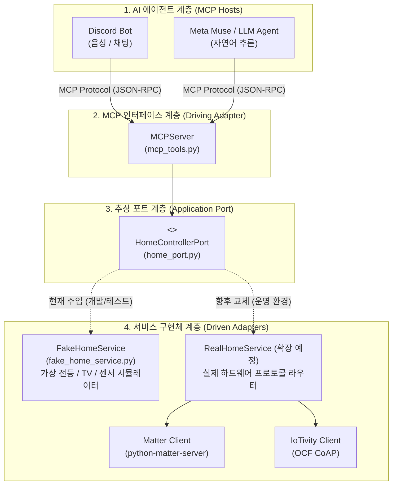
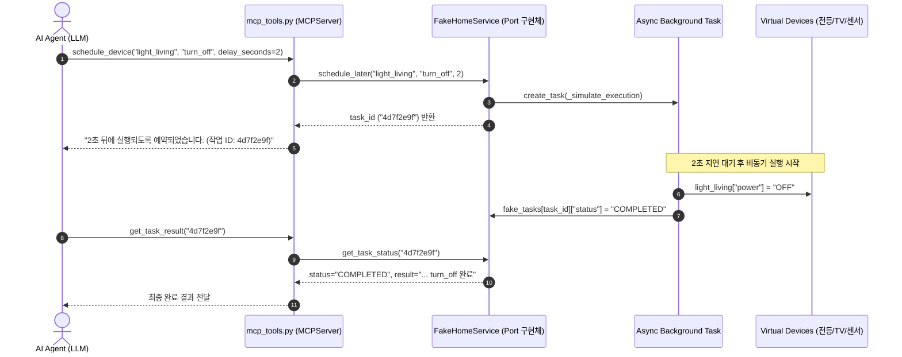

# System Architecture — virtual-to-matter-mcp

본 문서는 **`virtual-to-matter-mcp`**의 **포트와 어댑터(Hexagonal) 아키텍처** 및 **시뮬레이션(Virtual)에서 실제 IoT 프로토콜(Matter / IoTivity)로 확장 가능한 소프트웨어 구조**를 정의합니다.

---

## 1. 핵심 설계 원칙

- **의존성 역전 원칙 (DIP)**: 외부 접점인 `mcp_tools.py`는 구체적인 기기 제어 방식(가상 시뮬레이션 또는 실제 하드웨어 통신)을 전혀 알지 못하며, 오직 추상 인터페이스인 `HomeControllerPort`에만 의존합니다.
- **무수정 확장성 (Open-Closed Principle)**: 추후 실제 Matter나 IoTivity 프로토콜을 연동할 때 `HomeControllerPort`를 상속받은 `RealHomeService` 클래스만 새로 구현하여 주입하면, MCP Tool 정의나 에이전트 연동 코드는 단 한 줄도 수정할 필요가 없습니다.
- **테스트 용이성 (Testability)**: `pytest` 실행 시마다 초기화된 `FakeHomeService` 인스턴스를 주입하여 하드웨어 장비 없이도 기기 상태 전이와 지연 스케줄링을 결정론적으로 검증합니다.

---

## 2. 아키텍처 다이어그램

### ① 컴포넌트 및 의존성 구조 (Ports & Adapters)

### ② 지연 스케줄링 및 제어 처리 흐름 (Sequence Diagram)

---

## 3. 모듈별 상세 역할

| 파일명 | 계층 | 주요 역할 |
| :--- | :--- | :--- |
| **`mcp_tools.py`** | Driving Adapter | `MCPServer` 인스턴스 생성 및 LLM 에이전트용 Tool 스키마(`Literal`, `Field`) 노출 |
| **`home_port.py`** | Port (Interface) | 기기 조회, 즉시 제어, 지연 예약, 상태 조회 메서드를 강제하는 추상 기본 클래스(`ABC`) |
| **`fake_home_service.py`** | Driven Adapter | 실제 하드웨어 없이 가상 전등·TV·센서의 메모리 상태와 비동기 지연을 시뮬레이션하는 구현체 |
| **`test_mcp_home.py`** | Test Suite | 테스트 함수마다 깨끗한 `FakeHomeService`를 주입해 MCP Tool 동작을 검증하는 `pytest` 코드 |
