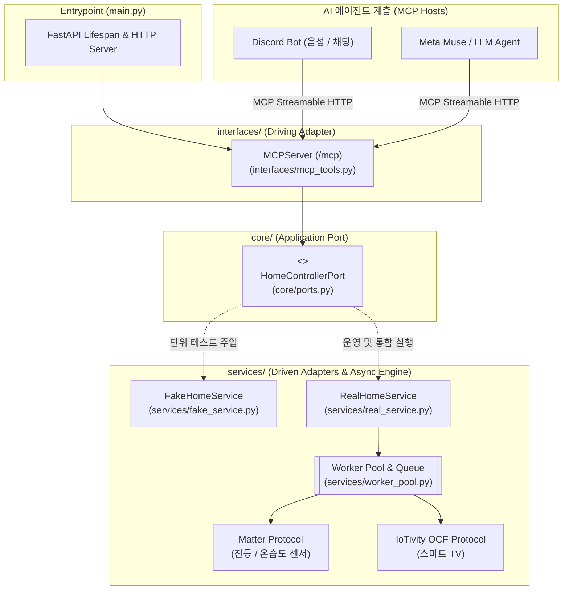
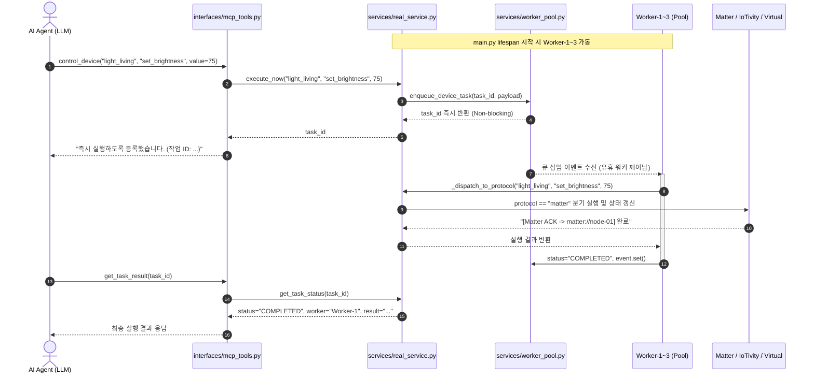

# System Architecture — virtual-to-matter-mcp

본 문서는 **`virtual-to-matter-mcp`**의 **포트와 어댑터(Hexagonal) 패키지 아키텍처** 및 **이벤트 드리븐 비동기 워커 풀 기반 스마트홈 제어 흐름**을 정의합니다.

---

## 1. 핵심 설계 원칙

- **계층화된 패키지 분리 (`core` / `services` / `interfaces`)**:
  - `core/`: 외부 프레임워크나 프로토콜에 전혀 의존하지 않는 순수 인터페이스(`HomeControllerPort`)를 정의합니다.
  - `services/`: 실제 작업을 수행하는 비동기 워커 풀(`worker_pool.py`), 테스트용 `FakeHomeService`, 프로토콜 라우팅을 담당하는 `RealHomeService`가 위치합니다.
  - `interfaces/`: AI 에이전트와 통신하는 `MCPServer` 도구(`mcp_tools.py`)를 담당합니다.
- **무폴링 이벤트 드리븐 워커 풀 (`Zero-Polling Worker Pool`)**:
  - `asyncio.Queue`와 `asyncio.Event`를 활용하여 주기적인 폴링 없이 작업 수신 및 완료 알림을 비동기적으로 처리합니다.
  - `WORKER_POOL_SIZE = 3`으로 동시 실행 개수를 제한하여 다중 에이전트 요청 폭주 시에도 시스템 안정성을 보장합니다.
- **무수정 프로토콜 확장성**: `RealHomeService` 내부의 프로토콜 분기(`Matter` vs `IoTivity`)를 실제 SDK 클라이언트로 교체하더라도 `interfaces/mcp_tools.py`나 `main.py`는 수정할 필요가 없습니다.

---

## 2. 아키텍처 다이어그램

### ① 패키지 및 컴포넌트 의존성 구조

### ② `RealHomeService` + 워커 풀 실행 시퀀스 다이어그램

---

## 3. 모듈별 상세 역할

| 패키지 / 파일 | 계층 | 주요 역할 |
| :--- | :--- | :--- |
| **`main.py`** | Entrypoint | FastAPI 애플리케이션 수명 주기(`lifespan`) 관리, 워커 풀 시작/종료 제어, `/mcp` 엔드포인트 마운트 |
| **`core/ports.py`** | Port | `HomeControllerPort` 추상 기본 클래스(`ABC`) 정의 |
| **`services/worker_pool.py`** | Async Engine | `asyncio.Queue`, `asyncio.Event`, `task_db` 및 3개의 비동기 워커 코루틴 생명주기 관리 |
| **`services/real_service.py`** | Driven Adapter | `HomeControllerPort` 구현체. 워커 풀에 작업을 위임하고 `Matter`/`IoTivity`/`Virtual` 분기 처리 |
| **`services/fake_service.py`** | Mock Adapter | 워커 풀 없이 단일 코루틴으로 빠르게 시뮬레이션하는 단위 테스트용 구현체 |
| **`interfaces/mcp_tools.py`** | Driving Adapter | `MCPServer` 인스턴스 및 4종의 LLM 호출용 `@mcp.tool()` 정의 |
| **`tests/`** | Test Suite | `test_mcp_fake.py`(6개) 및 `test_real_worker.py`(3개) 자동화 검증 코드 |
